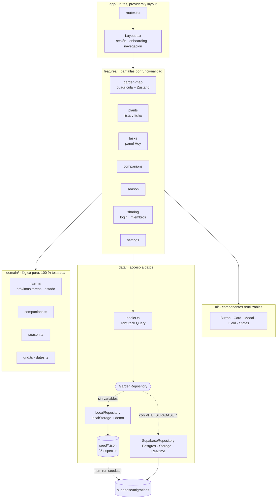

# 🌿 Mi Jardín

PWA gratuita y de código abierto para aficionados a la jardinería. Te ayuda a organizar lo que tienes plantado en tu jardín, huerto o terraza:

- **Mapa del jardín**: una cuadrícula editable donde dibujas zonas (bancales, macetas, césped…) y colocas las plantas arrastrándolas.
- **Fichas de planta**: especie, fecha de plantación, ubicación, foto y notas.
- **Riego y cuidados**: cada especie tiene su frecuencia de riego, poda y abonado. El panel **Hoy** te dice qué toca y puedes marcarlo como hecho.
- **Plantas compañeras**: al colocar una planta te avisa si cerca tiene una compatible ✅ o incompatible ⚠️.
- **Temporada**: qué se puede plantar cada mes según el clima (subtropical, pensado para Canarias, o templado).
- **Iconos de estado** en el mapa: sana, necesita riego o con cuidados atrasados.
- **Jardines compartidos**: invita a la familia y completad juntos las mismas tareas, con cambios en tiempo real.

Funciona **sin configurar nada** en modo demo, con un jardín de ejemplo guardado en el navegador.

> Este repositorio es también el proyecto base de una serie de vídeos donde pruebo herramientas de IA. Por eso el código está pensado para leerse: capas claras, lógica pura y testeada, y sin magia.

---

## Arranque rápido

Requisitos: Node.js 20 o superior.

```bash
npm install && npm run dev
```

Abre <http://localhost:5173>. Verás el **Huerto de ejemplo**: 14 plantas, 5 zonas y tareas pendientes, atrasadas y próximas.

| Comando              | Qué hace                                                   |
| -------------------- | ---------------------------------------------------------- |
| `npm run dev`        | Servidor de desarrollo                                     |
| `npm run build`      | Comprueba tipos y genera la versión de producción en `dist/` |
| `npm run preview`    | Sirve `dist/` para probar la PWA instalable                |
| `npm test`           | Ejecuta los tests (Vitest)                                 |
| `npm run coverage`   | Tests con cobertura (el dominio exige el 100 %)            |
| `npm run lint`       | ESLint                                                     |
| `npm run seed:sql`   | Regenera el SQL semilla a partir del catálogo JSON         |
| `npm run icons`      | Regenera los iconos de la PWA a partir de `public/favicon.svg` |

## Así se ve (capturas de texto)

**Hoy** (`/`)

```
┌───────────────────────────────────────┐
│ 🌿 Mi Jardín                    [Demo] │
├───────────────────────────────────────┤
│ Hoy en Huerto de ejemplo              │
│ 7 tareas pendientes                   │
│                                       │
│ Atrasadas (2)                         │
│ 🌹 🧪 Abonar Rosal          [✓ Hecho] │
│       Atrasada 10 días                │
│ 🌿 💧 Regar Albahaca        [✓ Hecho] │
│       Atrasada 2 días                 │
│                                       │
│ Para hoy (5)                          │
│ 🍅 💧 Regar Tomate          [✓ Hecho] │
│ 🫛 💧 Regar Judía verde     [✓ Hecho] │
│ …                                     │
│                                       │
│ Próximos 7 días                       │
│ 🥬 💧 Regar Lechuga · mañana          │
├───────────────────────────────────────┤
│  📋Hoy  🗺️Mapa  🌱Plantas  📅  ⚙️      │
└───────────────────────────────────────┘
```

**Mapa** (`/mapa`), con la herramienta *Plantar*

```
 [✋ Mover] [🌱 Plantar] [▭ Zona]
 🍅 🌿 🥬 🫑 🍆 🥒 …          ← arrastra una especie al mapa

 ┌─Bancal norte──────┐       ┌─Macetas──┐
 │ 🍅  🌿! 🍅💧       │       │ 🪴 🌿💧   │   🥭💧
 └───────────────────┘       └──────────┘
                              ┌─Arriate──────────┐
 ┌─Bancal sur────────┐        │ 🌹 💜        🌺   │
 │ 🥬 🥕 🧅💧         │        └──────────────────┘
 │             🫛💧  │        ┌─Césped───────────┐
 └───────────────────┘        └──────────────────┘

 ┌───────────────────────────────────────────┐
 │ Tomate colocada. ✅ buena compañía         │
 │ ✅ 🌿 Albahaca — ahuyenta la mosca blanca  │
 └───────────────────────────────────────────┘
 ✓ Sana (9)   💧 Necesita riego (5)   ! Cuidados atrasados (1)
```

Mientras arrastras, la casilla de destino se pinta de **verde** si hay vecinas compatibles, de **ámbar** si hay alguna incompatible y de **rojo** si ya está ocupada.

## Modo demo

Si no hay variables de Supabase, la app usa `LocalRepository`:

- Todo se guarda en `localStorage` de tu navegador (clave `mi-jardin:demo:v1`).
- La primera vez se crea el *Huerto de ejemplo*. Sus fechas se calculan respecto a hoy, así que siempre hay tareas que hacer.
- Las fotos se reducen a 800 px y se guardan como *data URL*.
- En **Ajustes → Restablecer jardín de ejemplo** vuelves a empezar.
- En la cabecera aparece la etiqueta **Demo**.

## Conectar Supabase

1. Crea un proyecto gratuito en [supabase.com](https://supabase.com).
2. Aplica las migraciones de `supabase/migrations/` en orden. Puedes hacerlo de dos formas:
   - Con la [CLI de Supabase](https://supabase.com/docs/guides/cli): `supabase link --project-ref <tu-ref>` y después `supabase db push`.
   - A mano: pega cada archivo en el **SQL Editor** del panel, en orden (`…01_schema`, `…02_rls`, `…03_seed`).
3. En **Authentication → URL Configuration**, añade `http://localhost:5173` (y tu dominio de producción) a *Site URL* / *Redirect URLs* para que funcione el enlace mágico.
4. Copia `.env.example` a `.env.local` y rellénalo con los datos de **Project Settings → API**:

   ```bash
   VITE_SUPABASE_URL=https://xxxxxxxx.supabase.co
   VITE_SUPABASE_ANON_KEY=eyJ...   # clave pública "anon"/"publishable"
   ```

5. `npm run dev`. Ahora te pedirá tu email, recibirás un enlace mágico y, la primera vez, crearás tu jardín.

> 🔐 **Nunca subas claves reales.** `.env.local` está en `.gitignore`. La clave `anon` es pública por diseño: la seguridad la ponen las políticas RLS. La clave `service_role` **no** debe usarse nunca en el frontend.

### Compartir un jardín

1. En **Ajustes → Compartir jardín**, el propietario escribe el email de la otra persona y pulsa *Invitar*. Se guarda en `garden_invites`.
2. Esa persona entra en la app con **ese mismo email**. Al iniciar sesión, la función `accept_garden_invites()` convierte la invitación en membresía.
3. Desde ese momento los dos veis el mismo mapa y las mismas tareas. Los cambios llegan en tiempo real (Supabase Realtime) y también al volver a la app.

La app no envía emails de invitación. Avisa tú a esa persona; el único correo que manda Supabase es el enlace mágico para entrar.

### Seguridad (RLS)

Todas las tablas tienen Row Level Security. La regla general la aplica una función `is_garden_member(garden_id)` (`SECURITY DEFINER`, para evitar la recursión entre políticas):

| Tabla                         | Leer                         | Escribir                                           |
| ----------------------------- | ---------------------------- | -------------------------------------------------- |
| `species`, `companion_rules`  | cualquier usuario con sesión | nadie (solo migraciones)                           |
| `gardens`                     | miembros                     | crear: tú como propietario · editar: miembros · borrar: propietario |
| `garden_members`              | miembros                     | altas solo por trigger o invitación · bajas: propietario o uno mismo |
| `garden_invites`              | miembros e invitado          | propietario                                        |
| `zones`, `plants`, `care_tasks` | miembros                   | miembros                                           |
| Storage `plant-photos`        | público (rutas con UUID)     | miembros del jardín de la carpeta                  |

## Arquitectura



Reglas de dependencia:

- **`domain/`** no importa nada de React, Supabase ni del navegador. Todas sus funciones reciben "hoy" como parámetro, así que los tests son deterministas. La cobertura exigida es del **100 %**.
- **`data/`** es la única capa que conoce Supabase o `localStorage`. Las pantallas usan los hooks de `data/hooks.ts`, que a su vez usan la interfaz `GardenRepository`.
- **`features/`** combina dominio y datos en pantallas. El estado efímero del mapa (herramienta activa, arrastre, zona en dibujo) vive en un store de **Zustand**. El estado del servidor vive en **TanStack Query**.
- **`ui/`** son componentes sin lógica de negocio.

Las tareas no se guardan: se **calculan**. `care_tasks` es el historial de cuidados hechos. La siguiente fecha es *último cuidado (o la fecha de plantación) + frecuencia de la especie*. Sin cron ni tareas duplicadas.

### Estructura

```
src/
  domain/        tipos y lógica pura: cuidados, compañeras, temporada, cuadrícula
  data/          repositorios (demo y Supabase), hooks de TanStack Query, auth, catálogo semilla
  features/
    garden-map/  mapa, herramientas, paleta y arrastre con pointer events
    plants/      lista, ficha, formulario y foto
    tasks/       panel Hoy y cuidados de cada planta
    companions/  avisos y ficha de compañeras
    season/      qué plantar cada mes
    sharing/     login con enlace mágico, nuevo jardín y miembros
    settings/    ajustes del jardín y cuenta
  ui/            componentes reutilizables y aviso de actualización de la PWA
  app/           rutas, providers y layout
supabase/
  migrations/    esquema, RLS y datos semilla
scripts/         generador del SQL semilla
```

## Stack

React 19 · Vite · TypeScript (modo estricto) · Tailwind CSS 4 · React Router · TanStack Query · Zustand · Supabase (Auth, Postgres con RLS, Storage, Realtime) · vite-plugin-pwa · Vitest + Testing Library.

## Desplegar en Vercel

El repo incluye `vercel.json`. Ese archivo redirige todas las rutas a `index.html` para que React Router funcione al recargar, y hace que el service worker no se quede en caché.

1. Entra en [vercel.com](https://vercel.com) con tu cuenta de GitHub y pulsa **Add New… → Project**.
2. Importa el repositorio `mi-jardin`. Vercel detecta Vite solo; no cambies nada.
3. **Sin variables de entorno**, la app se publica en modo demo. Cada visitante tiene su propio jardín de ejemplo en su navegador.
4. Para usar Supabase, añade `VITE_SUPABASE_URL` y `VITE_SUPABASE_ANON_KEY` en **Settings → Environment Variables** y vuelve a desplegar. Añade también la URL de Vercel (`https://….vercel.app`) a *Redirect URLs* en Supabase.

Cada `git push` a `main` despliega de nuevo automáticamente. Las ramas y pull requests tienen su propia URL de vista previa.

## PWA

- Se puede instalar en el móvil: *Añadir a pantalla de inicio* en Android o *Compartir → Añadir a inicio* en iOS.
- La interfaz se precachea, así que la app abre sin conexión. Las fotos de Supabase se guardan en caché al verlas.
- Cuando publicas una versión nueva, la app muestra el aviso *Hay una versión nueva* con el botón **Actualizar**.
- Para probarla en local: `npm run build && npm run preview`.

## Catálogo de especies

`src/data/seed/species.json` incluye 25 especies comunes de huerto y jardín. Las frecuencias de cuidado están en días y los meses de plantación, por clima. `companions.json` define 32 asociaciones simétricas.

Para añadir o corregir una especie: edita el JSON, ejecuta `npm run seed:sql` y aplica la migración. La demo y Supabase usan siempre el mismo catálogo.

Las frecuencias son orientativas, para un clima suave. Ajústalas a tu experiencia.

## Licencia

MIT.
